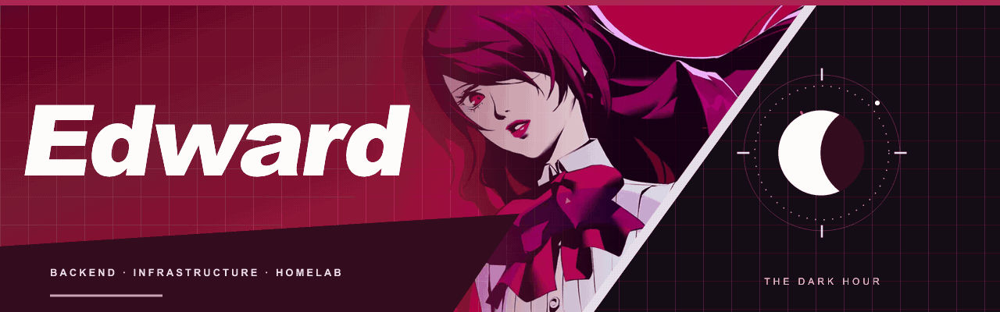

  

  <a href="#01--player-status">PLAYER STATUS</a> &nbsp; / &nbsp;
  <a href="#02--persona-compendium">COMPENDIUM</a> &nbsp; / &nbsp;
  <a href="#03--active-missions">MISSIONS</a> &nbsp; / &nbsp;
  <a href="#04--dark-hour--activity-log">ACTIVITY LOG</a>

  <strong>SRE by day. Homelab explorer during the Dark Hour.</strong> 
  Keeping systems reliable. Building, monitoring and automating — with a good soundtrack.

## 01 / INFO

Hey

I work with backend development and production environments, building tools and improving everyday workflows. **Python** is my go-to language, **Kubernetes** is part of my day-to-day work, and my homelab is where I build and explore self-hosted infrastructure and deployment automation.

Away from the terminal, you'll find me playing games, watching anime or listening to music.

| STATUS | CURRENT LOADOUT |
| :--- | :--- |
| Main focus | Backend development, Kubernetes and production environments |
| Favorite language | Python |
| Lab mode | Docker, self-hosting and CI/CD with Gitea + Komodo |
| Learning arc | Cloud, Flask, Kafka and Go |

## 02 / STACKS

### Tools I build with.

Backend, infrastructure and the systems behind my homelab.

| Field | Current loadout |
| :--- | :--- |
|  **Backend** | Python · RabbitMQ |
|  **Infrastructure** | **Kubernetes** · Linux · Docker · Docker Compose · Komodo |
|  **Observability** | Zabbix · Agent 2 · Grafana · PostgreSQL |
|  **Delivery** | Git · Gitea Actions · Gitleaks · Signed webhooks |
|  **Exploring** | Cloud · Flask · Kafka · Go  Currently learning |

## 03 / ACTIVE PROJECTS

### [Observability](docs/projects.md#observability)

A monitoring lab built with **Zabbix, Grafana and PostgreSQL**, with host monitoring through Agent 2 and a qBittorrent exporter. Compose validation and secret scanning run in Gitea Actions; the deployment workflows request updates through Komodo webhooks.

Monitoring · Metrics visualization · Persistent data · CI/CD

### [Docker Stacks](docs/projects.md#docker-stacks)

Self-hosted services managed with **Docker Compose and Komodo**, replacing the previous Portainer workflow. Stack-specific validation, Git history secret scanning and signed deployment webhooks connect Gitea to the homelab.

Self-hosting · Compose · Gitea Actions · Komodo · Gitleaks

## 04 / ACTIVITY LOG

<em>Every contribution builds the next floor.</em>

  

GitHub contribution activity · refreshed daily · Mitsuru palette

---

  <strong>SOCIAL LINKS</strong> 
  <a href="https://github.com/EdwardFlammel">GitHub / EdwardFlammel</a>

Fan-made profile inspired by Persona 3 Reload and Mitsuru Kirijo. Original banner composition with a fan-provided Mitsuru animation. Persona character artwork © ATLUS / SEGA. <a href="assets/CREDITS.md">Visual credits</a>.

