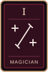
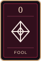
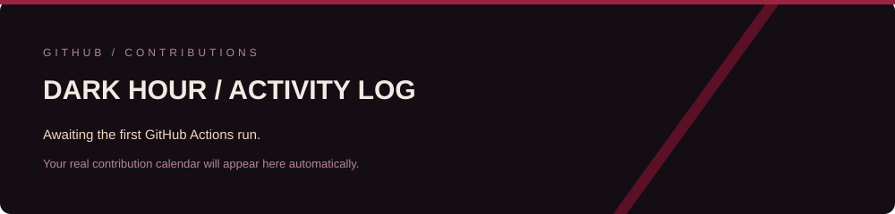

  

  <a href="#01--player-status">PLAYER STATUS</a> &nbsp; / &nbsp;
  <a href="#02--persona-compendium">COMPENDIUM</a> &nbsp; / &nbsp;
  <a href="#03--active-missions">MISSIONS</a> &nbsp; / &nbsp;
  <a href="#04--dark-hour--activity-log">ACTIVITY LOG</a>

  <strong>Backend developer by day. Homelab explorer during the Dark Hour.</strong> 
  Code, containers, anime and a good soundtrack.

## 01 / PLAYER STATUS

Hey, I'm **Eduardo** — you can call me **Edward**.

I work with backend development and production environments, building tools and improving everyday workflows. **Python** is my go-to language, and my homelab is where I experiment with self-hosting, infrastructure and deployment automation.

Away from the terminal, you'll find me playing games, watching anime or listening to music.

| STATUS | CURRENT LOADOUT |
| :--- | :--- |
| Main focus | Backend development and production environments |
| Favorite language | Python |
| Lab mode | Docker, self-hosting and CI/CD with Gitea + Komodo |
| Learning arc | Kubernetes, cloud, Flask, Kafka and Go |

## 02 / PERSONA COMPENDIUM

My technical loadout, organized by Arcana. Learning tools are listed separately from my current stack.

<h3> &nbsp; I · THE MAGICIAN / Backend & messaging</h3>

Python development and messaging tools from my backend stack.

<h3> &nbsp; IV · THE EMPEROR / Infrastructure & homelab</h3>

Linux hosts, self-hosted services and Docker Compose stacks managed with Komodo.

<h3> &nbsp; VIII · JUSTICE / Versioning & delivery</h3>

Git workflows, Gitea Actions, Compose validation, Gitleaks scans and signed deployment webhooks.

<h3> &nbsp; 0 · THE FOOL / Learning arc</h3>

The next floor: Kubernetes, cloud infrastructure and new backend tools. Currently studying.

## 03 / ACTIVE MISSIONS

| MISSION | OBJECTIVE |
| :--- | :--- |
| **The Homelab** | Maintain a self-hosted environment with Docker, Gitea and Komodo. |
| **Deployment Reload** | Validate Compose files, scan Git history for secrets and request deployments through signed webhooks. |
| **The Next Floor** | Keep exploring Kubernetes, cloud infrastructure and backend services. |

Build. Observe. Improve. Repeat.

## 04 / DARK HOUR / ACTIVITY LOG

<em>Every contribution builds the next floor.</em>

  

GitHub contribution activity · refreshed daily · Mitsuru palette

---

  <strong>SOCIAL LINKS</strong> 
  <a href="https://github.com/EdwardFlammel">GitHub / EdwardFlammel</a>

Fan-made profile inspired by Persona 3 Reload and Mitsuru Kirijo. Original banner composition with a fan-provided Mitsuru animation. Persona character artwork © ATLUS / SEGA. <a href="assets/CREDITS.md">Visual credits</a>.

